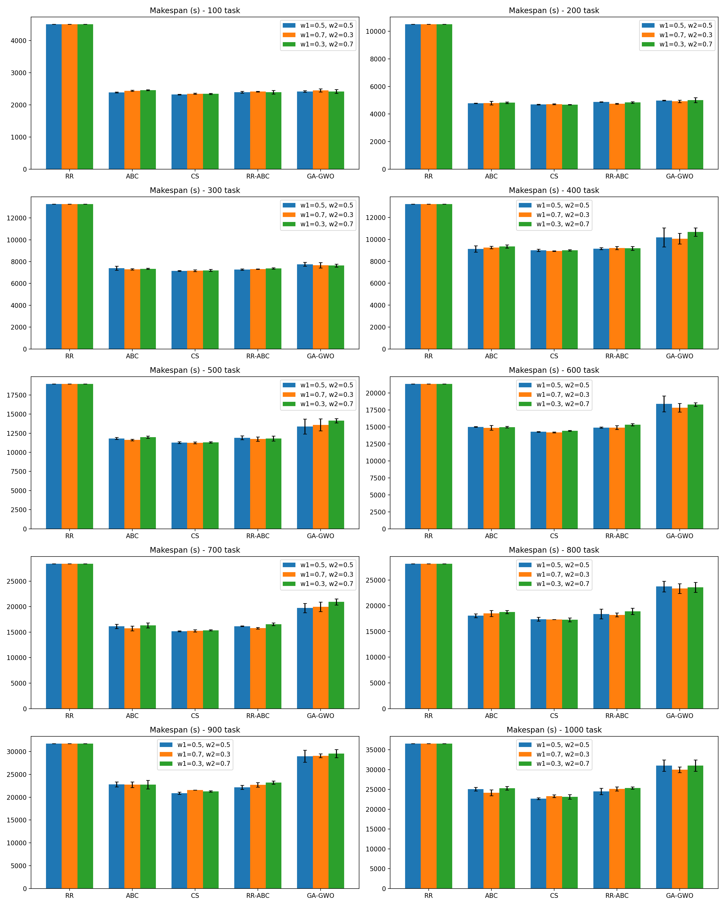
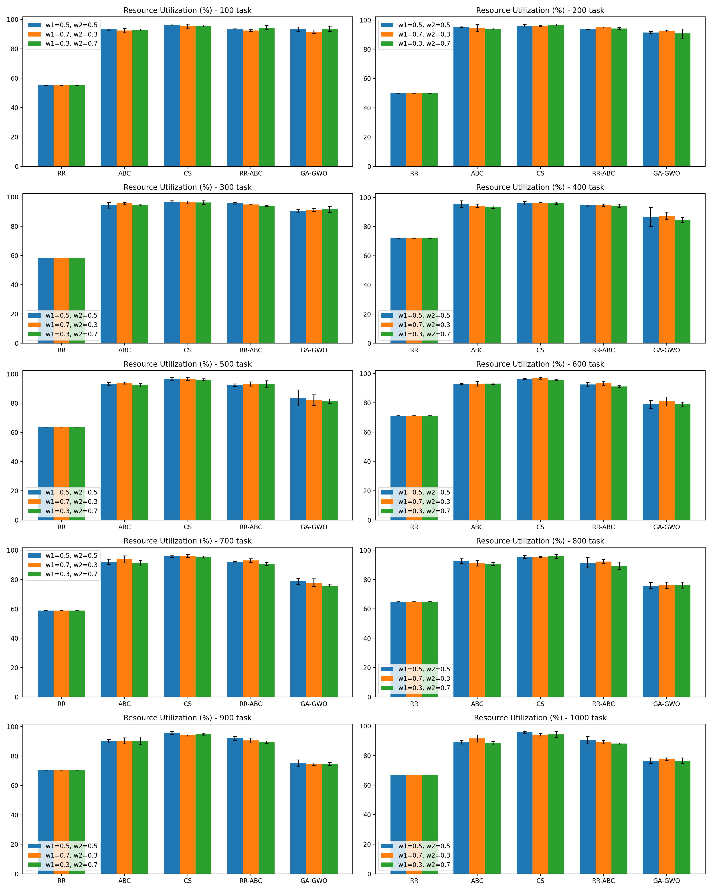
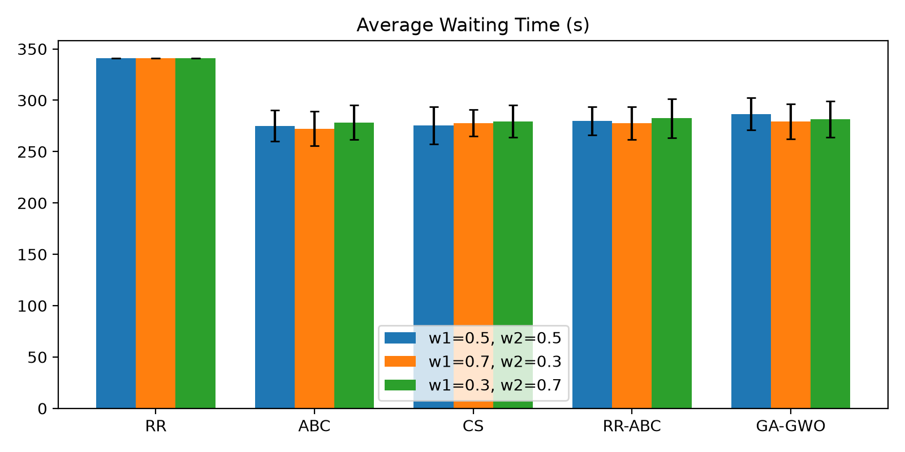

# Optimasi Penjadwalan Task pada Komputasi Awan (CloudSim)

Simulasi dan analisis perbandingan lima algoritma penjadwalan task (Round Robin, ABC, Cuckoo Search, hybrid RR-ABC, dan hybrid GA-GWO) pada lingkungan cloud heterogen menggunakan CloudSim 7.0.1.

**Kelompok 5 — Institut Teknologi Sepuluh Nopember**

| NRP | Nama |
|---|---|
| 5027241009 | Tasya Aulia Darmawan |
| 5027241043 | Azaria Raissa Maulidinnisa |
| 5027241090 | Tiara Fatimah Azzahra |
| 5027241104 | Afriza Tristan Calendra Rajasa |
| 5027201047 | Made Gde Krisna Wangsa |

---

## Daftar Isi

1. [Ringkasan Pendekatan](#ringkasan-pendekatan)
2. [Dataset dan Model Task](#dataset-dan-model-task)
3. [Desain Arsitektur Cloud](#desain-arsitektur-cloud)
4. [Fungsi Objektif dan Metrik](#fungsi-objektif-dan-metrik)
5. [Algoritma yang Diuji](#algoritma-yang-diuji)
6. [Protokol Eksperimen](#protokol-eksperimen)
7. [Hasil dan Analisis](#hasil-dan-analisis)
8. [Kesimpulan](#kesimpulan)
9. [Struktur Project](#struktur-project)
10. [Referensi](#referensi)

---

## Ringkasan Pendekatan

Berdasarkan telaah tiga jurnal *systematic literature review* (Khan et al., 2023; Abraham et al., 2024; Sanjalawe et al., 2025), riset task scheduling di cloud computing berevolusi dari algoritma heuristik konvensional menuju metaheuristik yang lebih fleksibel, hingga pendekatan hybrid yang menggabungkan kekuatan beberapa metode. Proyek ini mengikuti alur evolusi yang sama, dibagi tiga tahap:

| Tahap | Fokus | Algoritma |
|---|---|---|
| 1 | Baseline heuristik | Round Robin (RR) |
| 2 | Metaheuristik independen | Artificial Bee Colony (ABC), Cuckoo Search (CS) |
| 3 | Hybrid | RR-ABC (heuristik + metaheuristik), GA-GWO (metaheuristik + metaheuristik) |

## Dataset dan Model Task

- **Model task:** independent, non-preemptive, statis (semua task tersedia sejak awal simulasi).
- **Dataset:** [GoCJ (Google Cloud Jobs)](https://data.mendeley.com/datasets/b7bp6xhrcd/1) (Hussain et al., 2019), hasil pemodelan Monte Carlo dari Google cluster traces.
- **Sampel:** 40 baris pertama dari file dengan jumlah job terkecil, nilai MI (Million Instructions) dipetakan langsung sebagai `cloudlet length`.

## Desain Arsitektur Cloud

| Komponen | Spesifikasi | Jumlah |
|---|---|---|
| Datacenter | Satu datacenter tunggal | 1 |
| Host | Heterogen, 2 tipe | 4 (2 Host A + 2 Host B) |
| VM | Heterogen, 2 tipe | 8 (4 kecil + 4 besar) |
| Task/Cloudlet | Independent, non-preemptive | 40 cloudlet |

**Host:**

| Tipe | PE | MIPS | RAM | Bandwidth | Jumlah |
|---|---|---|---|---|---|
| A | 1 | 1000 | 2048 MB | 10000 | 2 |
| B | 1 | 2000 | 4096 MB | 10000 | 2 |

**VM:**

| Tipe | PE | MIPS | RAM | Jumlah |
|---|---|---|---|---|
| Kecil | 1 | 500 | 512 MB | 4 |
| Besar | 1 | 1000 | 1024 MB | 4 |

**Batasan (constraints):**
- Kapasitas VM tidak boleh dilampaui — dikelola otomatis oleh `VmSchedulerTimeShared` di CloudSim.
- Non-preemptive — diimplementasikan lewat `CloudletSchedulerSpaceShared`.
- Eksklusivitas eksekusi — satu task hanya dijalankan pada satu VM.

## Fungsi Objektif dan Metrik

Dua objektif digabungkan dengan pendekatan *weighted-sum*:

```
Fitness = w1 × makespan_normalisasi − w2 × utilization_normalisasi   (w1 + w2 = 1)
```

| Objektif | Arah | Metrik pendukung |
|---|---|---|
| Minimasi Makespan | ↓ | Average Waiting Time |
| Maksimasi Resource Utilization | ↑ | — |

Tiga skenario bobot diuji untuk *sensitivity analysis*:

| Skenario | w1 (makespan) | w2 (utilization) |
|---|---|---|
| Seimbang | 0.5 | 0.5 |
| Prioritas Kecepatan | 0.7 | 0.3 |
| Prioritas Efisiensi Resource | 0.3 | 0.7 |

## Algoritma yang Diuji

| Algoritma | Jenis | Catatan |
|---|---|---|
| Round Robin (RR) | Heuristik | Baseline, deterministik (1 run) |
| Artificial Bee Colony (ABC) | Metaheuristik | Kuat di *exploitation* |
| Cuckoo Search (CS) | Metaheuristik | Kuat di *exploration* (Lévy flight) |
| RR-ABC | Hybrid heuristik + metaheuristik | Sebagian populasi awal ABC diisi solusi RR |
| GA-GWO | Hybrid metaheuristik + metaheuristik | Fase GWO (eksploitasi alpha/beta/delta) + fase GA (seleksi, crossover, mutasi) |

Parameter: populasi 30, iterasi 100 (disamakan antar algoritma untuk kewajaran perbandingan).

## Protokol Eksperimen

- RR bersifat deterministik → dijalankan **1 kali**.
- ABC, CS, RR-ABC, GA-GWO bersifat stokastik → dijalankan **30 run independen** dengan seed berbeda (1000–1029).
- Hasil dilaporkan sebagai **rata-rata ± standar deviasi**.
- Validasi silang: makespan hasil perhitungan analitis dicocokkan dengan hasil simulasi CloudSim penuh (cocok 100% pada semua algoritma yang diuji).

## Hasil dan Analisis

### Makespan



### Resource Utilization



### Average Waiting Time



### Tabel Ringkasan (w1=0.5, w2=0.5)

| Algoritma | Makespan (s) | Utilization (%) | Waiting Time (s) | Perbaikan vs RR |
|---|---|---|---|---|
| RR | 1878.00 ± 0.00 | 45.27 ± 0.00 | 340.98 ± 0.00 | — |
| ABC | 828.03 ± 16.34 | 90.36 ± 1.93 | 275.20 ± 14.91 | 55.91% |
| CS | 801.02 ± 10.85 | 93.61 ± 1.31 | 275.64 ± 18.19 | **57.35%** |
| RR-ABC | 831.13 ± 19.64 | 90.40 ± 2.23 | 280.08 ± 13.68 | 55.74% |
| GA-GWO | 826.42 ± 31.60 | 91.45 ± 3.36 | 286.69 ± 15.57 | 55.99% |

### Tabel Ringkasan (w1=0.7, w2=0.3 — Prioritas Kecepatan)

| Algoritma | Makespan (s) | Utilization (%) | Waiting Time (s) | Perbaikan vs RR |
|---|---|---|---|---|
| RR | 1878.00 ± 0.00 | 45.27 ± 0.00 | 340.98 ± 0.00 | — |
| ABC | 825.43 ± 19.21 | 90.73 ± 2.03 | 272.38 ± 16.85 | 56.05% |
| CS | 804.53 ± 11.64 | 93.06 ± 1.60 | 277.86 ± 12.95 | **57.16%** |
| RR-ABC | 829.65 ± 18.70 | 90.48 ± 2.14 | 277.60 ± 15.82 | 55.82% |
| GA-GWO | 822.48 ± 29.46 | 91.51 ± 3.09 | 279.34 ± 16.97 | 56.20% |

### Tabel Ringkasan (w1=0.3, w2=0.7 — Prioritas Efisiensi Resource)

| Algoritma | Makespan (s) | Utilization (%) | Waiting Time (s) | Perbaikan vs RR |
|---|---|---|---|---|
| RR | 1878.00 ± 0.00 | 45.27 ± 0.00 | 340.98 ± 0.00 | — |
| ABC | 837.27 ± 16.53 | 90.11 ± 1.52 | 278.30 ± 16.77 | 55.42% |
| CS | 800.40 ± 10.55 | 93.70 ± 1.16 | 279.41 ± 15.68 | **57.38%** |
| RR-ABC | 842.92 ± 19.25 | 89.84 ± 1.87 | 282.59 ± 19.03 | 55.12% |
| GA-GWO | 825.98 ± 25.98 | 91.53 ± 2.02 | 281.49 ± 17.72 | 56.02% |

### Pembahasan

**1. Semua algoritma metaheuristik dan hybrid unggul jauh dari baseline.** RR menghasilkan makespan 1878 s dengan utilization hanya 45%, karena task dibagi rata tanpa memperhitungkan panjang task maupun kapasitas VM — task panjang yang kebetulan jatuh ke VM kecil menjadi bottleneck. Keempat algoritma lain memangkas makespan sekitar **55–57%** dan menaikkan utilization ke **90–94%**, konsisten di ketiga skenario bobot.

**2. Cuckoo Search konsisten menjadi yang terbaik** di semua skenario bobot, dengan makespan terendah (~800–805 s, mendekati batas bawah teoretis ~753 s) dan utilization tertinggi (~93–94%). Ini sejalan dengan karakteristik CS di literatur sebagai algoritma yang kuat dalam *exploration* melalui mekanisme Lévy flight — pada ruang solusi berdimensi 40 dengan 8 pilihan VM, eksplorasi luas ini rupanya lebih efektif dibanding eksploitasi lokal ala ABC.

**3. Hybrid RR-ABC tidak mengungguli ABC murni** — bahkan sedikit lebih lambat di semua skenario bobot (contoh: 831 vs 828 pada w=0.5/0.5). Solusi awal Round Robin (makespan 1878, jauh dari optimal) rupanya tidak menjadi titik awal yang menguntungkan bagi ABC; sebagian populasi yang "diseed" dari RR justru mengurangi keragaman awal tanpa memberi keunggulan posisi yang berarti. Ini menjadi temuan kritis: hipotesis "solusi awal heuristik mempercepat konvergensi metaheuristik" **tidak terbukti** pada kasus dataset dan skala arsitektur ini.

**4. GA-GWO kompetitif di rata-rata namun paling tidak stabil.** Utilization-nya termasuk tinggi (~91–92%), tapi standar deviasi makespan-nya jauh lebih besar (25–32) dibanding CS (~11) atau ABC (~16–20). Artinya performa GA-GWO lebih bervariasi antar run — kadang mendekati CS, kadang mendekati ABC.

**5. Bobot fungsi objektif tidak banyak mengubah peringkat algoritma.** Ketiga skenario (0.5/0.5, 0.7/0.3, 0.3/0.7) menghasilkan urutan performa yang sama (CS > GA-GWO ≈ ABC > RR-ABC), karena makespan dan resource utilization pada desain ini berkorelasi kuat — memperbaiki satu metrik cenderung memperbaiki metrik lainnya juga.

**6. Validasi.** Hasil analitis (perhitungan langsung dari mapping) dan hasil simulasi penuh CloudSim identik untuk semua algoritma yang diuji, mengonfirmasi bahwa formula makespan dan utilization yang dipakai selama optimasi sudah benar.

## Kesimpulan

Pada skala arsitektur cloud heterogen kecil-menengah (4 host, 8 VM) dengan 40 task independent dari dataset GoCJ, **Cuckoo Search adalah algoritma dengan performa terbaik**, diikuti GA-GWO dan ABC yang relatif setara, sementara hybrid RR-ABC tidak memberikan keuntungan dibanding ABC murni. Temuan ini menegaskan bahwa penggabungan heuristik dengan metaheuristik tidak otomatis meningkatkan performa — efektivitasnya bergantung pada seberapa dekat solusi awal heuristik dengan area solusi optimal.

## Struktur Project

```
cloudsim-soka/
├── pom.xml
├── results.csv          # hasil tiap run (30 run × 4 algoritma × 3 bobot)
├── summary.csv           # rata-rata ± std dev per algoritma per skenario bobot
├── mk_mean.png            # grafik makespan
├── util_mean.png          # grafik resource utilization
├── wait_mean.png          # grafik average waiting time
├── analyze.py             # skrip olah data (pandas + matplotlib)
└── src/main/
    ├── java/soka/
    │   ├── Main.java          # entry point, jalankan seluruh eksperimen
    │   ├── CloudEnv.java      # setup datacenter, host, VM (CloudSim)
    │   ├── DatasetLoader.java # loader dataset GoCJ
    │   ├── Metrics.java       # makespan, utilization, waiting time, fitness
    │   └── algo/
    │       ├── Scheduler.java     # interface algoritma
    │       ├── RoundRobin.java
    │       ├── ABC.java
    │       ├── CuckooSearch.java
    │       ├── RRABC.java
    │       └── GAGWO.java
    └── resources/
        └── gocj_sample.txt    # 40 baris sampel dataset GoCJ
```

### Cara Menjalankan

```bash
cd cloudsim-soka
mvn compile exec:java -Dexec.mainClass=soka.Main
python3 analyze.py
```

## Referensi

- Khan, Z. A., Aziz, I. A., Osman, N. A. B., & Ullah, I. (2023). A Review on Task Scheduling Techniques in Cloud and Fog Computing. *IEEE Access*, 11, 143417–143445.
- Abraham, O. L., Ngadi, M. A. B., Sharif, J. B. M., & Sidik, M. K. M. (2024). Task Scheduling in Cloud Environment. *IEEE Access*, 12, 138252–138279.
- Sanjalawe, Y., Al-E'mari, S., Fraihat, S., & Makhadmeh, S. (2025). AI-driven Job Scheduling in Cloud Computing. *Artificial Intelligence Review*, 58, Art. 197.
- Hussain, A., Aleem, M., Khan, A., Iqbal, M. A., & Islam, M. A. (2019). GoCJ: Google Cloud Jobs Dataset. *Data*, 4(38).
- Alhaidari, F., & Balharith, T. Z. (2021). Enhanced Round-Robin Algorithm in the Cloud Computing Environment. *Computers*, 10(5), 63.
- Tawfik, M. A., Bahgat, A., Keshk, A., & Torkey, F. A. (2015). Artificial Bee Colony Algorithm for Cloud Task Scheduling. *IJCI*, 4(1), 1–10.
- Agarwal, M., & Srivastava, G. M. S. (2018). A Cuckoo Search Algorithm-Based Task Scheduling in Cloud Computing. *AISC*, Vol. 554, Springer.
- Kruekaew, B., & Kimpan, W. (2020). Enhancing of Artificial Bee Colony Algorithm for VM Scheduling and Load Balancing. *IJCIS*, 13(1), 496–510.
- Behera, I., & Sobhanayak, S. (2024). Task Scheduling Optimization in Heterogeneous Cloud Computing Environments: A Hybrid GA-GWO Approach. *JPDC*, 183, 104766.